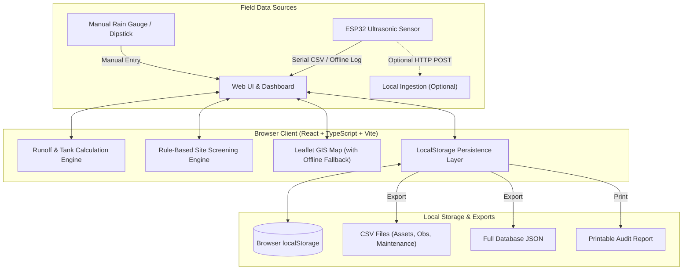

# System Architecture: JalSetu Purulia

## 1. High-Level Overview
JalSetu Purulia is a local-first web application designed for student teams, panchayat functionaries, and local water-harvesting coordinators in Purulia district, West Bengal. It emphasizes transparent workflows, offline reliability, prioritization of restoration before new construction, and honest separation of physical measurements from estimates.

## 2. Main Components

### A. Frontend Presentation Layer
- **Framework**: React 18 with TypeScript.
- **Build Tool**: Vite 6 (fast development and optimized production bundling).
- **Styling**: Standard CSS with a custom design system (`src/index.css`) utilizing a calm, practical palette (deep blue `#1a5276`, muted teal `#1a8a7d`, sand `#f5f0e8`, and natural earth tones). Minimal purposeful animation, no SaaS templates, no emoji-based icons.
- **Charts**: Recharts 2.x for responsive time-series visualization (rainfall events vs tank water depth).
- **Mapping**: Leaflet 1.9.4 with OpenStreetMap tiles. Includes an automatic offline fallback that renders a geo-located asset list if OSM tiles fail to load.

### B. Business Logic & Calculation Layer
- **Rainwater Harvesting Calculator (`src/lib/calculations.ts`)**:
  - Implements $Volume (m^3) = Rainfall (mm) \times Catchment (m^2) \times Efficiency \div 1000$.
  - Unit conversion and storage overflow comparison.
  - Rectangular tank geometric formula: $V = L \times W \times D$.
  - Sensor reading plausibility validation.
- **Rule-Based Site Screening Engine (`src/lib/screening.ts`)**:
  - Transparent heuristic evaluation across 8 weighted factors.
  - Handles missing data explicitly by discounting maximum achievable score.
  - Favours repair and restoration of existing water assets over new construction.

### C. Local Persistence Layer (`src/lib/storage.ts`)
- Stores all data in `window.localStorage` under key `jalsetu_purulia_data`.
- Operates 100% offline without requiring paid cloud hosting, login credentials, or external API keys.
- Provides full CRUD operations, automated timestamping, and two-way JSON/CSV data exchange.

### D. Embedded Sensor Interface (`firmware/`)
- ESP32 microcontroller sketch interfacing with HC-SR04 or waterproof JSN-SR04T ultrasonic sensors.
- Real-time noise rejection (multi-sample averaging), distance-to-depth calibration, and serial CSV output.
- Operates primarily in offline serial logging mode to match remote rural conditions.

## 3. Data Flow
1. **Site Assessment**: A user inputs physical observations (slope, soil, existing pond condition, ownership). The screening engine calculates a provisional feasibility score and highlights missing data.
2. **Asset Registration**: Confirmed structures are saved with dimensions, condition, and maintenance status into the local database.
3. **Monitoring**: Manual dipstick readings or sensor exports are logged. Rectangular tank geometry calculates instantaneous storage volume.
4. **Maintenance Tracking**: Identified defects (e.g., siltation, leakages, blocked gutters) are triaged, assigned, and tracked through to resolution.
5. **Reporting**: The system compiles cross-cutting summaries for print or CSV/JSON export.

## 4. Failure Handling & Reliability
- **Offline Map Fallback**: When internet connection is unavailable or OpenStreetMap tiles cannot be reached, the map component displays a fallback summary list of coordinates and asset conditions.
- **Sensor Glitch Rejection**: Firmware rejects acoustic pings `< 2 cm` (sensor blind-zone) or `> 450 cm` (out-of-range).
- **Data Boundary Checks**: Software warns if water level readings exceed physical tank dimensions by `> 10%`.
- **Corrupted Storage Recovery**: If localStorage contains invalid JSON, the storage layer logs a console warning and gracefully recovers without crashing the UI.

## 5. Security & Privacy Considerations
- **No Telemetry / No Tracking**: The application contains no analytics scripts, third-party cookies, or remote telemetry.
- **Zero Hardcoded Secrets**: No API keys, passwords, or cloud tokens exist in the repository.
- **Local Isolation**: All user-entered records remain exclusively on the user's local machine unless intentionally exported as CSV/JSON.
