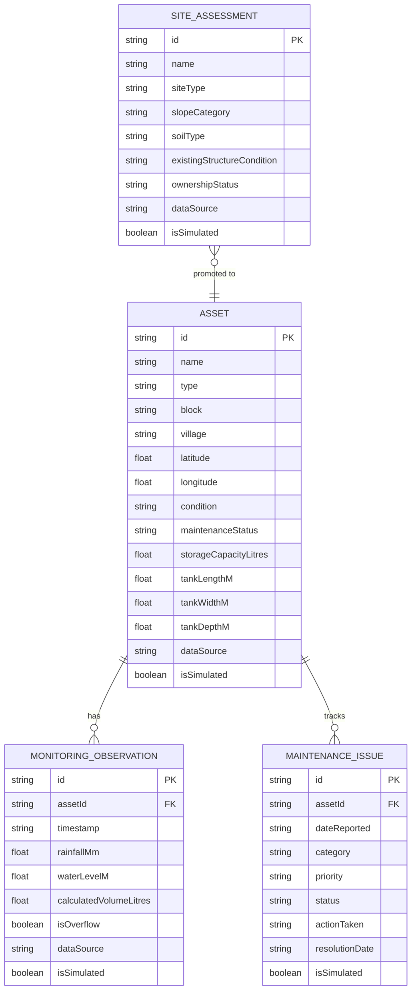

# Data Model Specification: JalSetu Purulia

This document defines the data structures, entities, and relationship models used throughout JalSetu Purulia.

## 1. Entity Overview

## 2. Entity Specifications

### `Asset`
Represents an existing or newly constructed physical water conservation structure.
| Field | Type | Description |
|---|---|---|
| `id` | string | Unique identifier (e.g. `asset-a1b2c3d4`) |
| `name` | string | User-friendly asset name |
| `type` | `AssetType` | `rooftop_rwh`, `pond`, `check_dam`, `percolation_tank`, `recharge_shaft`, `farm_pond`, `channel`, `other` |
| `block` | string | Purulia administrative block (e.g. Purulia-I, Hura, Arsha) |
| `village` | string | Village or locality name |
| `latitude` | number \| null | GPS latitude in decimal degrees |
| `longitude` | number \| null | GPS longitude in decimal degrees |
| `installationDate`| string | ISO date or empty string |
| `condition` | `AssetCondition` | `good`, `fair`, `poor`, `non_functional`, `unknown` |
| `responsibleOrg`| string | Panchayat, school committee, or individual caretaker |
| `maintenanceStatus`| `MaintenanceStatus` | `none_required`, `scheduled`, `overdue`, `in_progress`, `unknown` |
| `storageCapacityLitres`| number \| null | Calibrated capacity in Litres |
| `catchmentAreaSqm`| number \| null | Contributing surface area in square metres |
| `tankLengthM` | number \| null | Internal length for rectangular vertical tanks (m) |
| `tankWidthM` | number \| null | Internal width for rectangular vertical tanks (m) |
| `tankDepthM` | number \| null | Internal maximum depth (m) |
| `notes` | string | Field observations and description |
| `dataSource` | string | Origin of record (defaults to "Not verified / demonstration entry") |
| `isSimulated` | boolean | `true` if record is demonstration data; `false` if user-entered |
| `createdAt` | string | ISO timestamp |
| `updatedAt` | string | ISO timestamp |

### `SiteAssessment`
Represents a preliminary survey of a candidate location before any physical work is approved.
| Field | Type | Description |
|---|---|---|
| `id` | string | Unique identifier |
| `name` | string | Candidate site title |
| `siteType` | `SiteType` | `rooftop`, `existing_pond`, `drainage_channel`, `agricultural_land`, `other` |
| `slopeCategory` | `SlopeCategory`| `flat`, `gentle`, `moderate`, `steep`, `unknown` |
| `soilType` | `SoilType` | `alluvial`, `laterite`, `red_soil`, `sandy`, `clay`, `rocky`, `mixed`, `unknown` |
| `geologyInfo` | string | Geological notes (weathered zone thickness, bedrock type) |
| `existingStructure`| string | Description of pre-existing structure (if any) |
| `existingStructureCondition`| `AssetCondition`| Condition of pre-existing asset |
| `waterDemand` | string | Qualitative intended demand |
| `ownershipStatus`| `OwnershipStatus`| `government`, `community`, `private_with_permission`, `private_no_permission`, `disputed`, `unknown` |
| `constraints` | string | Documented limitations (access, road, rocks) |
| `dataSource` | string | Origin of record (defaults to "Not verified / demonstration entry") |

### `ScreeningFactor` & `ScreeningResult`
Defines the rule-based evaluation of site feasibility.
| Field | Type | Description |
|---|---|---|
| `factor` | string | Name of evaluation factor (1 of 8) |
| `score` | number | Points assigned (0 to 10) |
| `maxScore` | number | Maximum possible points (10) |
| `weight` | number | Factor importance weighting (0.10 to 0.15) |
| `notes` | string | Specific rationale for awarded score |
| `isCritical` | boolean | `true` if this factor is one of the 5 baseline requirements |
| `screeningImpact` | string | Detailed engineering explanation of how this factor impacts screening |

#### `ScreeningResult`
| Field | Type | Description |
|---|---|---|
| `totalScore` | number | Weighted score sum |
| `maxPossibleScore` | number | Maximum theoretical weighted score (10.0) |
| `percentage` | number | Score percentage (suppressed if `isInsufficient` is true) |
| `suitability` | string | `high`, `moderate`, `low`, or `insufficient_data` |
| `factors` | `ScreeningFactor[]` | Breakdown of all 8 evaluated factors |
| `recommendation` | string | Actionable guidance for field engineers |
| `missingData` | string[] | List of all omitted attributes |
| `isInsufficient` | boolean | `true` if any critical baseline factor is missing |
| `criticalMissing` | string[] | Specific list of missing baseline requirements |

### `MonitoringObservation`
Periodic reading of weather and storage levels.
| Field | Type | Description |
|---|---|---|
| `id` | string | Unique reading identifier |
| `assetId` | string | Foreign key referencing `Asset.id` |
| `timestamp` | string | ISO 8601 timestamp |
| `rainfallMm` | number \| null | Precipitation event in millimetres |
| `waterLevelM` | number \| null | Measured water depth in tank/pond (metres) |
| `calculatedVolumeLitres`| number \| null| Calculated volume from rectangular formula |
| `isOverflow` | boolean | `true` if depth exceeds tank height |
| `dataSource` | `DataSourceType`| `manual_gauge`, `sensor_esp32`, `estimated`, `simulated` |
| `sensorStatus` | string | `ok`, `warning`, `error`, `offline`, `not_applicable` |

### `MaintenanceIssue`
Tracks physical degradation, blockages, and necessary repairs.
| Field | Type | Description |
|---|---|---|
| `id` | string | Unique issue identifier |
| `assetId` | string | Foreign key referencing `Asset.id` |
| `dateReported` | string | ISO date |
| `category` | `IssueCategory` | `blockage`, `siltation`, `damaged_component`, `leakage`, `structural`, `sensor_failure`, `inspection_overdue` |
| `priority` | `IssuePriority` | `low`, `medium`, `high`, `critical` |
| `status` | `IssueStatus` | `open`, `in_progress`, `resolved` |
| `actionTaken` | string | Free-text description of repair / desilting |
| `resolutionDate`| string | ISO date or empty |
